

# MH4U Custom Quest Editor (Citra edition)

Create and edit your own quests for **Monster Hunter 4 Ultimate** (3DS) and play them on **Citra**
(or a real 3DS, untested). This is a continuation of **dasding's MH4U Custom Quest Editor v2.1.5**:
every editing feature of the original is kept, but the proxy it used to send quests to the game, which
stopped working when the 3DS online services closed, is replaced by **writing the quests straight into the
game's event quest files**, with automatic backups. There is no ROM hack: the game is never changed.
A Windows program, with an English or French interface.

New in 3.5: the first public release. A review pass made the *In-game quests* page faster with many
backups, keeps the collections when a library backup is restored, and reloads the list from the files
if a write ever fails. See [CHANGELOG.md](CHANGELOG.md).

New in 3.4: **quest check** (a ⚠ badge lists what the game may refuse with *"You cannot accept this
Quest data"*, with one-click fixes), **auto-fill of the Supply Box**, proposals for objectives and
requirements, the common values of the official quests behind a **?**, the game's **original quests
brought back from your backups**, **library backups and restore**, and **Ctrl+F** in every page.

New in 3.1-3.3: **automatic quest IDs**, an **ID picker**, auto-fill of **rewards** and **small
monsters**, official spawn positions, real HP / damage of a monster, a built-in **Guide**, **collections**
in the library, and browsers for monsters, maps, items and icons.

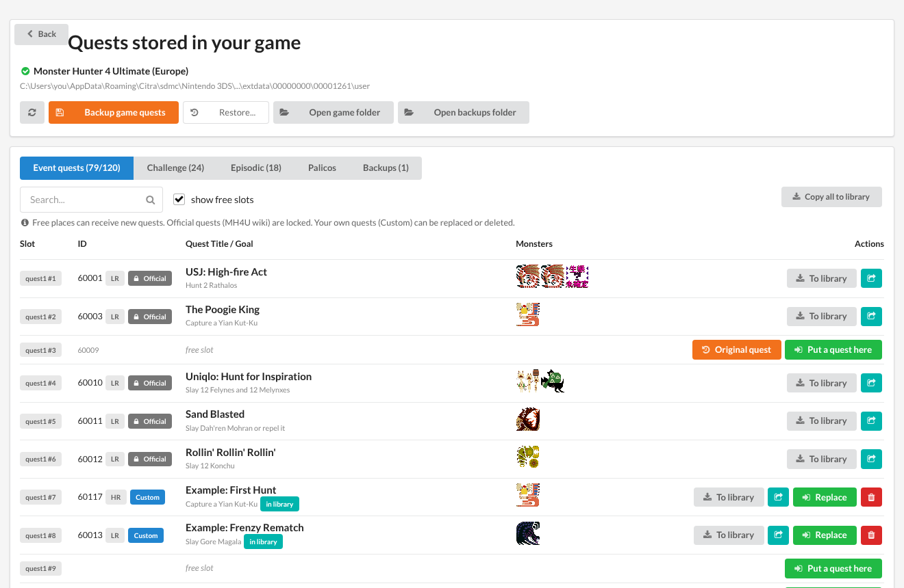

---

## ⚠️ Legal notice - please read first

* This is an **unofficial fan-made tool**. It is **not affiliated with, endorsed by or supported by
  Capcom or Nintendo**. *Monster Hunter* is a trademark of Capcom Co., Ltd.
* **This repository contains no game**: no ROM, no save and no quest file of the game. To use the
  editor you must **own a legal copy of Monster Hunter 4 Ultimate**. It does include the small monster
  icons and map pictures the editor displays (from the original editor and the game); they are
  Capcom's artwork and stay Capcom's property (see [THIRD_PARTY.md](THIRD_PARTY.md)).
* **Never share** ROMs, extracted game files or your save files, and do not attach them to Issues or
  Discussions.
* **Use at your own risk.** Editing quest files can corrupt a save or crash the game. The code is
  provided "as is" under the MIT licence, without warranty. **Keep backups** (see
  [What the editor changes and what to back up](#what-the-editor-changes-and-what-to-back-up)).
* Please do not use modified quests to disturb other players online.

More in [SECURITY.md](SECURITY.md) and [THIRD_PARTY.md](THIRD_PARTY.md).

## Contents

1. [What it does](#what-it-does)
2. [Requirements](#requirements)
3. [Installation](#installation)
4. [Quick start: your first custom quest](#quick-start-your-first-custom-quest)
5. [What the editor changes and what to back up](#what-the-editor-changes-and-what-to-back-up)
6. [Quest IDs](#quest-ids)
7. [Real 3DS](#real-3ds)
8. [What was tested, and what was not](#what-was-tested-and-what-was-not)
9. [Advice](#advice)
10. [Share your experience](#share-your-experience)
11. [Troubleshooting](#troubleshooting)
12. [Command line, tests and tools](#command-line-tests-and-tools)
13. [Security, credits and licence](#security-credits-and-licence)

## What it does

MH4U keeps the quests it once downloaded (event, challenge and episodic quests, DLC palicos) in files
of its extra data: `quest1`..`quest5` and `otomo1`. The editor reads them, shows them slot by slot,
and writes your quests into them, where the game lists them like its own event quests. You start from
a new quest or from a copy of an official one, change what you like, and send it to the game. Every
write is preceded by a backup of the six files.

| Page | What it is |
|---|---|
| **Quest Library** | Your quests, kept by the editor: edit, copy, export / import (`.mib`, `.cmib`), collections, *To game*, *Send selected to game*, *Backup library* / *Restore library*. The *Citra* box at the top says which save was found. |
| **In-game quests** | What is in the game: *Event quests* (`quest1`-`quest3`), *Challenge* (`quest4`), *Episodic* (`quest5`), *Palicos* (`otomo1`) and *Backups*. Copy to the library, put a quest in a slot, replace or clear your own quests, bring back an official quest from a backup, restore a backup. |
| **Editor** | Tabs *General* (header, requirements and objectives, preview icons), *Monsters* (large, unstable, small), *Supply Box*, *Rewards*, *Text* (5 languages). |
| **Palico editor** | The DLC palicos (`.otb`), from the original editor. |
| **Guide** | What the numbers mean, measured from the game: monster stats with a calculator, monsters, the *Special* field, quest IDs, maps, hidden parameters. A copy is in [docs/GUIDE.md](docs/GUIDE.md). |
| **Settings** | Citra folder, backups, language, credits. |

### Features

* **Straight into the game:** finds Citra's save by itself (Citra, Lime3DS, Azahar, a portable Citra, or
  a folder you choose), lists every slot, and writes quests where they belong: a quest whose ID is
  already in the game replaces it, otherwise it takes the first free slot of its category. A window
  shows where each quest goes before anything is written. A warning appears if the emulator is running.
* **Automatic IDs:** leave the quest ID at **0 (Auto)**; the editor picks a free ID of your game when
  you send the quest, and saves it in your library. The **ID picker** lists your own slots and the free
  IDs that work with any monster, and on demand the free IDs with conditions or all of them.
* **Official quests are locked:** the 78 event, 24 challenge and 18 episodic quests of the game (MH4U
  wiki lists) are never replaced or deleted. You can still copy them to the library as a base.
* **Quest check:** a ⚠ badge in the editor lists what the game may refuse: a refill that points to a
  supply box that does not exist, a hunt / slay / capture objective without a monster, an ID used with
  monsters it does not list, rewards that do not add up to 100 %. Simple cases are fixed in one click.
  The same checks appear before a quest is written into the game.
* **Auto-fill** from the official quests of the same map, rank and monsters: **rewards** (tables A, B and
  subquest, with the rare items of the monsters), **Supply Box** (map items, standard kit, refills, box by
  box), **small monsters** (the most common layout of each area, or the layout of one official quest).
* **Help to choose values:** a **?** next to fees, Zenny and HRP shows the values of the official quests
  of the same star rank; proposals for the main objectives, subquest and requirements; official spawn
  positions in each area; the real HP, damage dealt and damage taken of a large monster; standard values
  (low, high, G rank, highest in the game) for Health, Attack and Resistance.
* **Browsers:** monsters by type, species and an estimated difficulty, with their base HP; maps as pictures; items
  by category and by monster; preview icons.
* **Backups:** the game files before every write (`Backups`), a button for a manual backup, restore in
  one click (the current state is backed up first). The **original quests** of the game are found in
  your backups: a slot that lost its official quest offers to put it back, and an emptied slot keeps
  showing its ID.
* **Library:** collections (name and colour, grouped view, move, export one collection), and **library
  backups** (`Library_Backups`: every 12 hours, before *Delete all* and before a restore, or with the
  button; 30 kept), restored in one click or from a `.cmib` file.
* **Ctrl+F** in every page (guide, editor tabs...), and the interface text can be selected and copied.
* **English or French** for everything added by this edition; the original interface also exists in
  Spanish, German, Italian and Chinese.

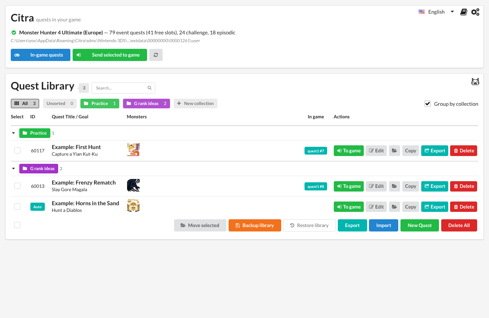
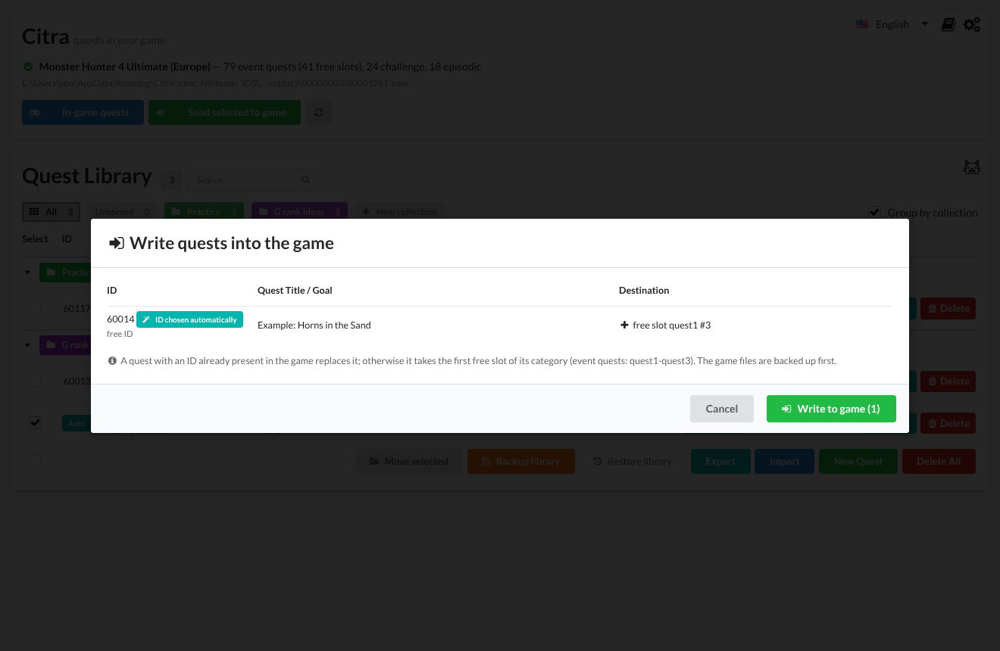

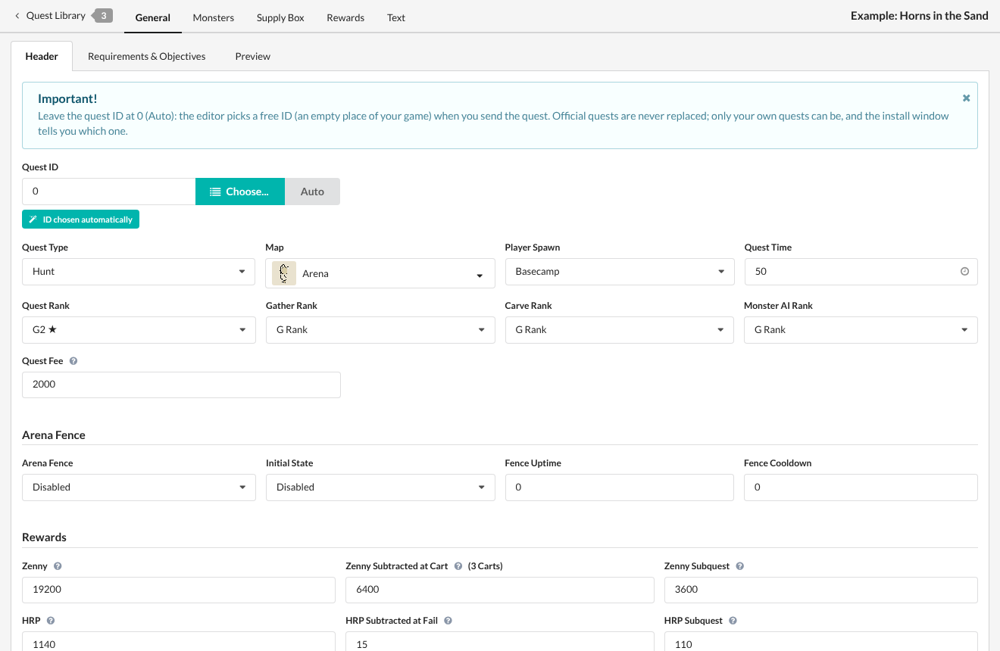
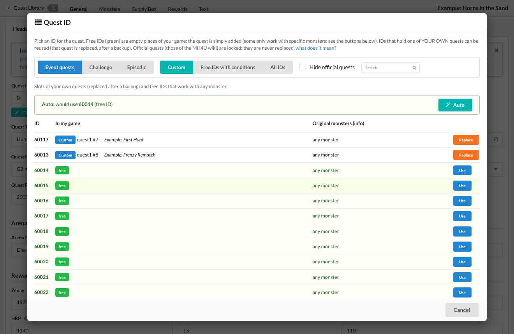

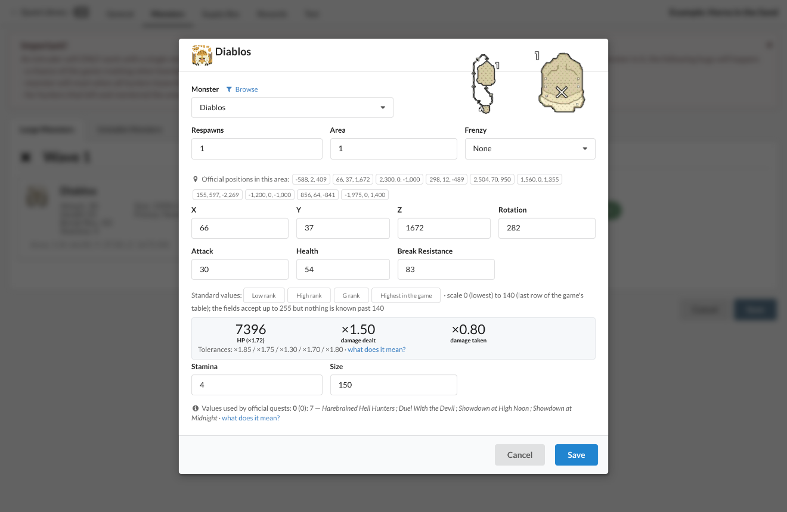
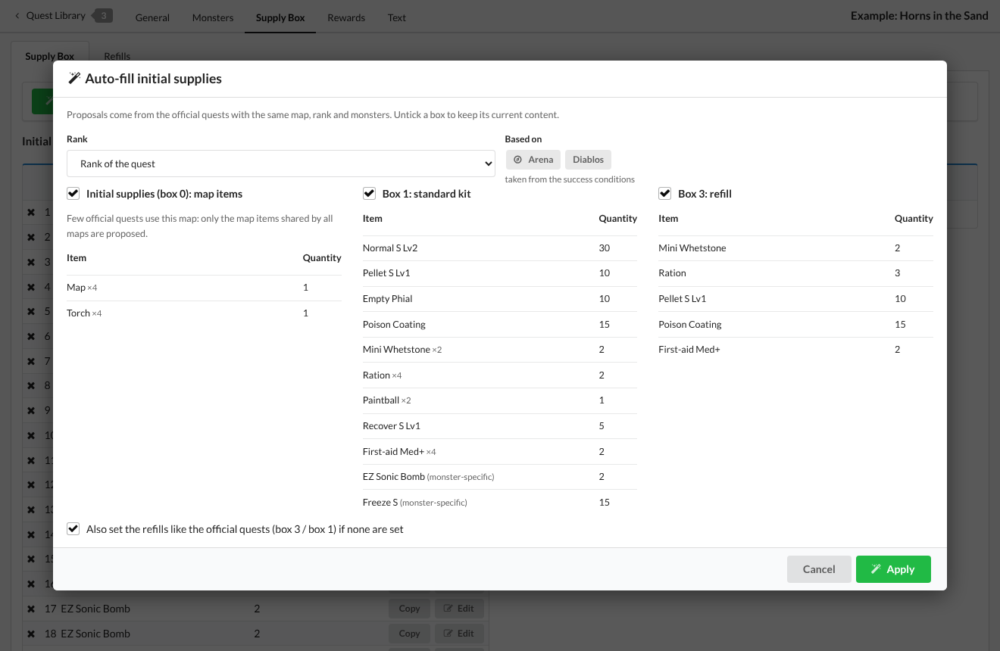

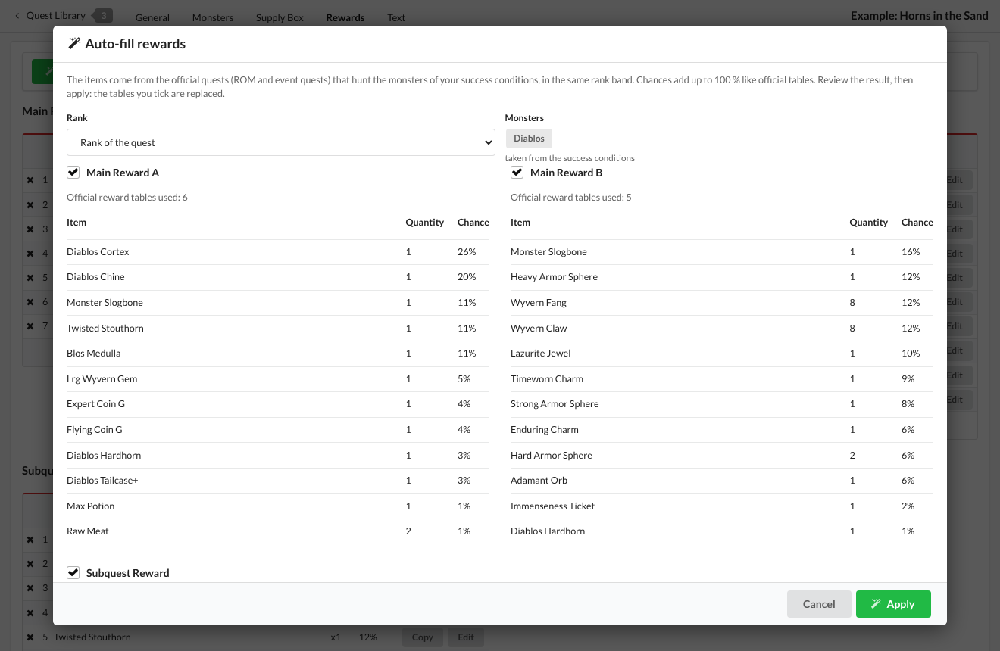
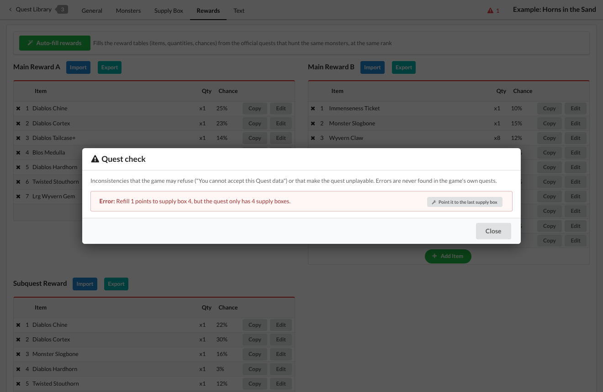

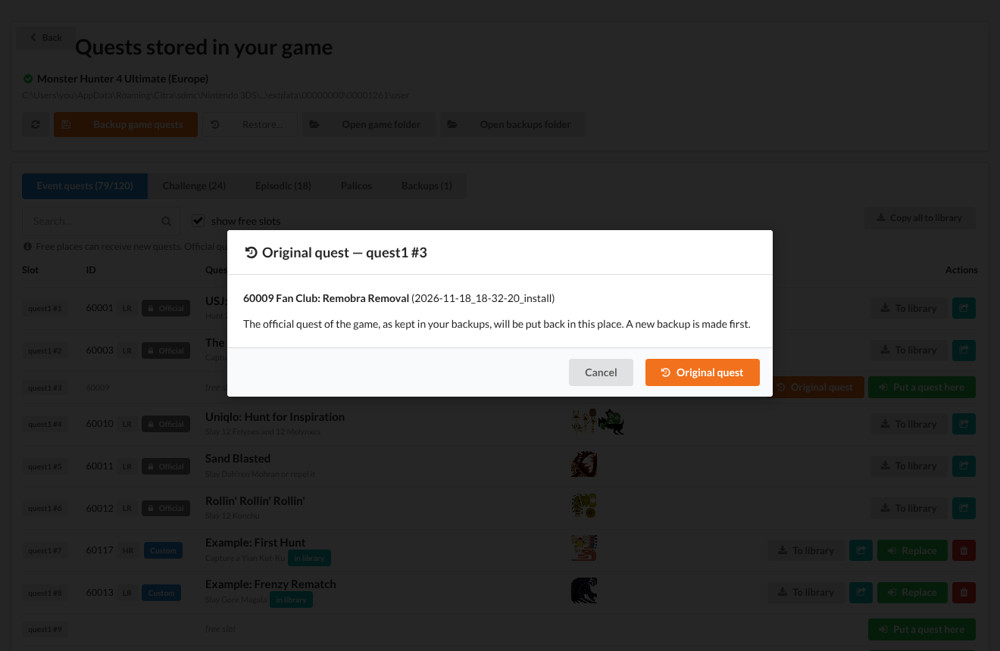
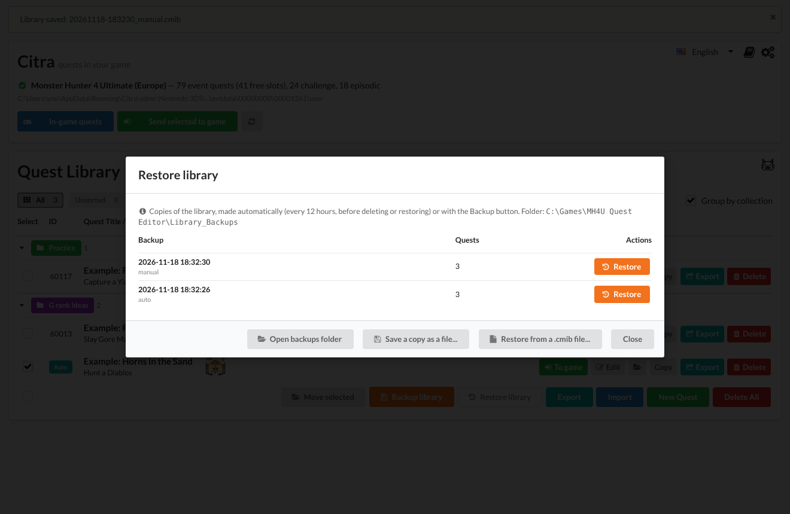

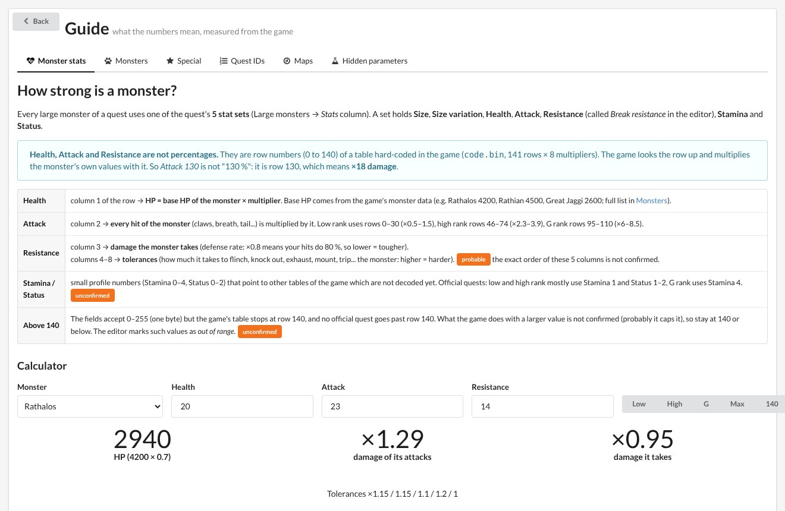
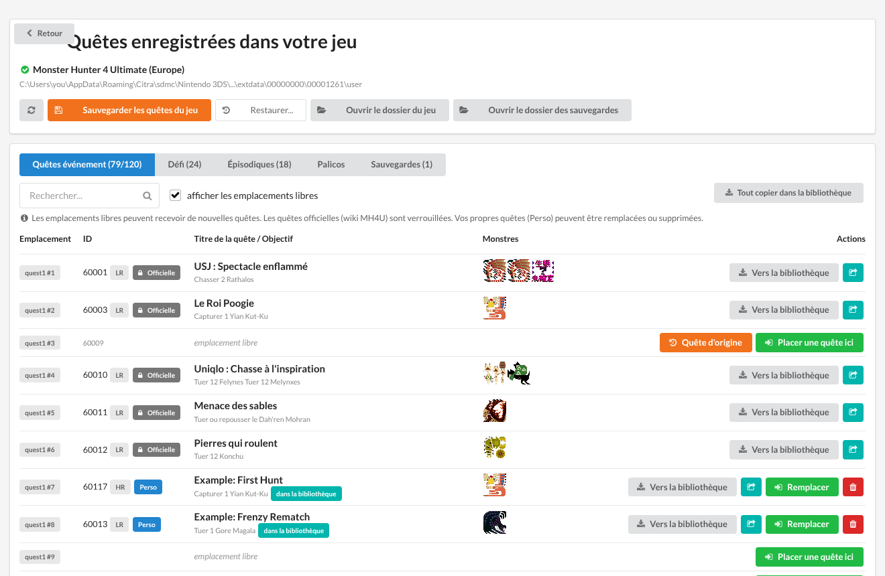

## Requirements

| | |
|---|---|
| **Game** | Your own legal copy of *Monster Hunter 4 Ultimate*. The **European** version was used for everything (extra data `00001261`). The North American version (`00001263`) is recognised but untested; the Japanese *MH4G* was not studied. |
| **To play** | **Citra** (or a fork: Lime3DS, Azahar...), **or** a real 3DS with custom firmware and a save manager such as **Checkpoint** / JKSM (untested). Start the game **once** so that its quest files exist. |
| **Computer** | **Windows** (tested). Nothing to install: the program comes with its runtime (NW.js). |
| **Optional** | **Node.js**, to run the tests; **Python 3**, to rebuild the exe from the sources. |

No internet connection is needed. The only links that go online are the ones you click in *Settings*.

## Installation

1. **Download** the latest `MH4U-Custom-Quest-Editor-vX.Y.Z-windows.zip` from the
   [Releases](../../releases) page (the repository itself holds the sources, see
   [Command line, tests and tools](#command-line-tests-and-tools)).
2. **Unzip** it anywhere you can write (not inside *Program Files*): the editor writes its `Backups` and
   `Library_Backups` folders next to itself.
3. **Start** `MH4U Quest Editor.exe`. Windows SmartScreen may warn about an unknown program the first
   time (*More info > Run anyway*).
4. **First start:** the *Citra* box of the library page shows the save that was found, with the number of
   quests and free slots. If it says *not found*, start MH4U once in Citra, quit it, and press the
   refresh button, or choose the folder yourself in *Settings > Citra folder > Browse* (Citra's user
   folder, its `sdmc` folder, or directly the folder that holds `quest1`..`quest5`).

The quest library of dasding's editor is found again automatically: the editor keeps the same storage.

### Updating

Download the new release and unzip it over the old folder (or into a new folder and move your
`Backups` and `Library_Backups` folders into it). Your library is not in that folder, it stays where it
is. Make a *Backup library* first anyway.

## Quick start: your first custom quest

1. **Quit the game** in Citra before writing quests (the editor warns if Citra is running).
2. Open **In-game quests > Event quests** and press **To library** on an official quest that is close
   to what you want: **same map**, similar monsters and rank. Or press **New Quest** in the library.
3. In the library, press **Edit**. Keep the **Quest ID at 0 (Auto)**. Change the tabs *General*,
   *Monsters*, *Supply Box*, *Rewards* and *Text*. The **?** icons and *what does it mean?* links explain
   the values; the auto-fill buttons give official-like supplies and rewards.
4. Look at the **⚠ badge** in the editor's top bar: fix what it lists, then **Save**.
5. In the library press **To game** (or tick several quests and **Send selected to game**). The window
   shows the ID that will be used and the slot it goes to. Confirm: a backup is made, then the quest is
   written.
6. Start MH4U: the quest is in the **event quests** of the Gathering Hall.

If the game freezes or refuses the quest, restore the backup (*In-game quests > Backups*) and read
[Troubleshooting](#troubleshooting).

## What the editor changes and what to back up

**Everything the editor can write, and where:**

| What | Where | When |
|---|---|---|
| **The game's quest files** `quest1`..`quest5` (event, challenge, episodic quests) and `otomo1` (palicos) | `C:\Users\<you>\AppData\Roaming\Citra\sdmc\Nintendo 3DS\<id0>\<id1>\extdata\00000000\00001261\user`, found automatically (or the folder chosen in *Settings*) | *To game*, *Send selected to game*, *Put a quest here*, *Replace*, *Clear*, *Original quest*, *Restore*, palico actions |
| **Game backups** | `Backups\<date>_<reason>\` next to the exe (or the folder chosen in *Settings*): the six files, `backup.json`, and an `index.json` that lists their quests | Before every write (skipped when nothing changed since the last one), and *Backup game quests* |
| **Library backups** | `Library_Backups\` next to the `Backups` folder: one `.cmib` file per backup, the 30 newest are kept | Every 12 hours when the library opens, before *Delete All*, before a restore, and *Backup library* |
| **Your library** | Inside the editor's NW.js profile (browser storage of the app named `mh4u-quest-editor`), like the original editor | Always |
| **Files you export** | Where you choose | *Export*, *Save a copy as a file...* |

Besides Citra's settings file (`config\qt-config.ini`, only read, to find a custom SD card folder), the
editor reads and writes nothing else: not the ROM, not your game save (`user1`), nothing in Citra's
other folders. A file is always written to a temporary file first, then renamed, so a crash
never leaves half a file.

**What you should back up yourself, before your first write:**

1. The **`user` folder** above (it holds `quest1`..`quest5`, `otomo1` and your save `user1`): copy it
   somewhere safe. The editor's backups are next to the program; a copy you made yourself cannot be
   touched by a bug.
2. Your **library**: *Backup library* writes a copy in `Library_Backups`; *Restore library > Save a copy as
   a file...* gives you a `.cmib` to keep elsewhere.
3. Your whole save if you play on a real 3DS (Checkpoint / JKSM).

**The game backups** are never deleted by the editor. If the folder grows too big, delete old ones
yourself but keep the oldest one: it holds the game's original quests, which the editor uses for
*Original quest*.

## Quest IDs

The game only shows a downloaded quest if its ID is in the list of DLC IDs written in its program,
and it keeps each kind of quest in its own file:

| Kind | IDs | File | Slots |
|---|---|---|---|
| Event quests | 60001-60252 (121 IDs) | `quest1`, `quest2`, `quest3` | 3 × 40 |
| Challenge quests | 61001-61280 | `quest4` | 40 |
| Episodic quests | 62101-62212 (the game only knows the 18 official ones) | `quest5` | 40 |

* **0 = Auto** (recommended): when the quest is sent, the editor uses a **free ID** (an ID that no quest
  of your game uses) that works with any monster, or with the monsters of the quest. When none is left,
  it reuses the ID of **one of your own quests**, which is then replaced after a backup (the install
  window says which one), and only then a free ID that asks for other monsters. **Official quests are
  never used.**
* The **ID picker** (*Choose...* next to the ID) has three views: *Custom* (your own slots and the free
  IDs that work with any monster, the default), *Free IDs with conditions* and *All IDs*.
* The game's program also lists the **original monsters of many IDs**. Whether the game really refuses
  other monsters on them is not known, so the editor does not block anything: the picker shows them and
  the quest check warns. Prefer IDs that work with any monster.
* If the game answers ***"You cannot accept this Quest data"***: open the quest, read the ⚠ list (a refill
  pointing to a missing supply box and an objective without a monster are the usual causes), and if
  nothing is listed, try another ID.

The details, with the full list of IDs and their status in your game, are in *Guide > Quest IDs*.

## Real 3DS

The quest files of a real console are the same as Citra's, so:

1. With **Checkpoint** (or JKSM), back up MH4U's **extra data** and copy it to your PC.
2. In the editor, *Settings > Citra folder > Browse* and choose the copied folder that holds
   `quest1`..`quest5`.
3. Write your quests, then restore the extra data to the 3DS with Checkpoint.

The author has **not** tried this on real hardware: please tell how it went.

## What was tested, and what was not

The author could test on **Citra (European version, Windows)** only; this table says honestly what
rests on a test in the game and what rests on reading the game's files.

| Topic | Status |
|---|---|
| Reading and writing `quest1`..`quest5` / `otomo1` (encryption, checksum) | ✅ Every file of a real save is decoded and written back byte for byte (tests) |
| Custom quests written into event slots, played in Citra | ✅ Tested in Citra |
| Quest export: 139 quests of a real save read, written and read again identically; none over the 8192-byte limit of a slot | ✅ Tests (the original exporter could exceed the limit) |
| One quest was refused (*"You cannot accept this Quest data"*) on ID 60117 and accepted on 60024 after the fixes of the quest check | ⚠️ The cause of the refusal on 60117 is not known: if a quest is refused, try another ID |
| Original monsters of the IDs (read from the game's program) | 🔎 Whether the game enforces them is not known; the editor only warns |
| Official quest detection (wiki lists, by ID and title) | 🔎 78 event, 24 challenge and 18 episodic quests |
| Auto-fill of rewards, Supply Box and small monsters; common values; proposals | 🔎 Computed from the official quests (data only, nothing new for the game) |
| Monster stats (HP, damage, tolerances): table of 141 rows read from the game's program | 🔎 The order of the 5 tolerance columns and the meaning of *Stamina* / *Status* are not confirmed; values above 140 are not documented |
| Original quests from the backups, backups as a source, library backups and restore | 🔎 Checked by the tests and in a browser with copies of real files |
| Challenge IDs 61251-61280, palico slots after the first | ⚠️ Experimental |
| Online play with other players | ❔ The game is not modified, so it should keep working when every player has the same quest; not tried |
| **Real 3DS**, North American and Japanese versions, Lime3DS / Azahar | ❔ Not tested by the author: please report |

Not possible without modifying the game (ROM hacking): new monsters, maps or items, or more than
3 × 40 event slots. Relic weapons and armor can be given as rewards, but what they turn into comes from
the save, not from the quest (see *Guide > Hidden parameters*).

## Advice

* **Back up first** (the `user` folder and your library), and again whenever you reach a quest you are
  proud of.
* **Quit the game before writing**, and restart it to see the change.
* **Start from an official quest on the same map** with similar monsters, then change a few things at
  a time and test in the game.
* Leave the **ID at 0 (Auto)**; use the picker's *Custom* view when you want to choose.
* Watch the **⚠ badge**: it warns about what can make the game refuse a quest.
* Use the **auto-fill** buttons and the **standard values** instead of typing raw numbers.
* Share quests as **`.mib`** files from the library (or `.cmib` for a collection), never the raw game files.

## Share your experience

This editor is maintained by one person who could not test everything. **Your feedback is what makes
it better.** Please:

* open an **Issue** for a bug, a crash or a quest that does not load (what you did, the editor version,
  Citra or 3DS, the ⚠ list of the quest), or for something unclear;
* start a **Discussion** to tell what you made, what you tested on real hardware, which settings behave
  differently from what the guide says, and which ideas you want;
* **share your quests** as `.mib` / `.cmib` files (only ones you created or changed: a quest copied
  unchanged from the game is Capcom's data).

**Please never attach game files** (ROM, `quest1`..`quest5`, `otomo1`, `user1`).

## Troubleshooting

| Problem | What to try |
|---|---|
| *Citra save not found* | Start MH4U once in Citra and quit it, then press the refresh button. Or *Settings > Citra folder > Browse*: Citra's user folder (portable Citra: the `user` folder next to it), its `sdmc` folder, or the folder that holds `quest1`..`quest5`. *Settings* lists the folders that were tried. |
| My quest is not in the game | Quit and restart the game after writing. Check *In-game quests*: is the quest in an event slot (`quest1`-`quest3`)? |
| *"You cannot accept this Quest data"* | Open the quest and fix what the ⚠ badge lists, write it again; if nothing is listed, give it another ID (picker, *Custom* view). |
| The game freezes when loading the quest | Restore the last backup (*In-game quests > Backups*), then start again from an official quest of the same map. |
| *No free slot* / no ID left | Clear one of your own quests in *In-game quests*, or replace it (*Replace*). Official quests stay locked. |
| An official quest is missing from the game | *In-game quests*: its slot shows *Original quest* when one of your backups still holds it. |
| My library is empty or wrong | *Restore library* (library page) lists the library backups; *Restore from a .cmib file...* for a file you kept. |
| The emulator-running warning stays | Close Citra / Lime3DS / Azahar completely (also from the system tray), then refresh. |
| I want everything back as it was | *In-game quests > Backups* and restore the oldest backup, or copy back your own copy of the `user` folder. |

## Command line, tests and tools

The program needs nothing but the release folder. For developers, the repository holds the readable
sources of the application (`source/`, an NW.js app: AngularJS 1.4, Semantic UI, ES5 only, as the
runtime is from 2016), the tests and the tools.

**Rebuild the exe** after a change in `source/` (Python 3, standard library only). The NW.js runtime is
taken from an existing exe, the one of a release (or dasding's `editor.exe`):

    python tools/build_exe.py --runtime "<release folder>\MH4U Quest Editor.exe"

It writes `MH4U Quest Editor.exe` at the root of the repository; copy it over the one of a release
folder (the other files of the runtime, `nw.pak`, `icudtl.dat`, the dlls, are needed next to it).
`python tools/make_release.py --runtime-dir "<release folder>"` makes the whole release zip in `dist/`.

**Tests** (Node.js; the tests that read game files need a folder holding `quest1`..`quest5` and
`otomo1`, for example one of your game backups; nothing of the game is in the repository):

    node tests/run_all.js <folder with quest1..quest5 and otomo1>

`test_core.js` (encryption and pack format, byte-for-byte rewrite), `test_mib_roundtrip.js` (every quest
read, exported and read again), `test_autoid.js` (automatic IDs against the real files),
`test_check.js` (quest check), `test_library_collections.js` (collections and library backups).

**Interface tests and screenshots** (Python 3 with Playwright, Chrome): `tests/ui/serve.py` serves the
application to a browser with an in-memory copy of the game files (`tests/ui/shim.js` stands in for
NW.js), and `tests/ui/screenshots.py` walks through the main features and takes the pictures of
`docs/images/`. See the top of each file.

**Game data:** `source/app/data/gamedata.js` holds the facts the editor needs (difficulty table, base
HP, DLC IDs and their monsters, official quest titles, statistics of the official quests). It was
computed from the author's copy of the game with the scripts of `tools/gamedata/` (see its README).

**Layout:** `app/utils/citra_core.js` (encryption and format of the game files), `citra.js` (finding
Citra, reading, planning and writing, backups), `mib.js` (quest format, import / export), `otb.js`
(palicos), `library.js` (library, collections, `.cmib`), `gamedata.js` + `data/gamedata.js` (game data,
auto-fill, quest check, IDs), `findbar.js` (Ctrl+F); `app/views/library/`, `editor/` (with
`editor_extras.js`), `game/` (*In-game quests*), `guide/`, `palico_editor/`, `settings/`;
`app/locales/citra_texts.js` (texts of this edition, English and French). Technical notes on the files
and what was found in the game: [docs/RESEARCH.md](docs/RESEARCH.md).

## Security, credits and licence

* **Security and legal:** [SECURITY.md](SECURITY.md). The editor is offline and only touches the folders
  listed above.
* **Credits:** the original **MH4U Custom Quest Editor** is by **dasding** (v2.1.5, MIT licence), with
  thanks from its author to Ina, MH-Slice, Knorr and Statyk, and translations by Hairo and Anthony
  (Spanish), Ina (French), lys1030 (Chinese), AxisXY (Italian) and dasding (German). Lists of the
  official quests from the [Monster Hunter Wiki](https://monsterhunterwiki.org/) and the
  [Monster Hunter Fandom wiki](https://monsterhunter.fandom.com/). Details in
  [THIRD_PARTY.md](THIRD_PARTY.md).
* **Licence:** MIT for the code and original files ([LICENSE](LICENSE)); the game and Capcom's artwork
  (the small pictures in `source/img/`) belong to Capcom and are not covered by it. Version history:
  [CHANGELOG.md](CHANGELOG.md).
